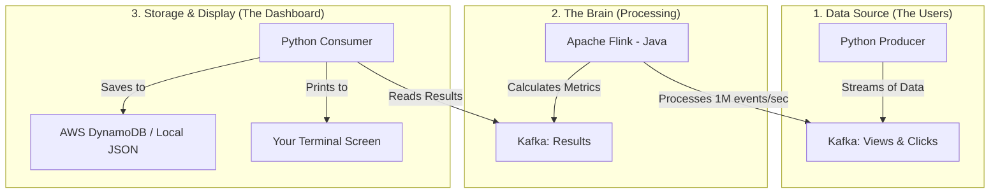

# 🚀 Ad-Vantage: The Ultimate Real-Time Ad Analytics Bible

## 📖 1. What is this project? (The "Big Picture")
Imagine you are a global marketing manager for a company like **Nike** or **Apple**. Every second, millions of people around the world are seeing your digital ads (**Views**) and thousands are clicking on them (**Clicks**).

**Ad-Vantage** is the "Real-Time Brain" that watches these two massive streams of data. It instantly matches every click to the exact view that caused it, calculates how well the ad is performing (Click-Through Rate), and stores the results in a high-speed database. 

**The result?** You can see exactly which ads are working *right now*, not tomorrow or next week.

---

## 🌟 2. Key Features (What can it do?)
This pipeline is not just counting numbers; it's doing complex math in milliseconds:
1.  **Identity Matching**: It matches "Click #502" to "View #502" even if they happened on different websites or at different times.
2.  **Global Totals**: Running counts of every View and Click for every Ad on every Website.
3.  **The "Efficiency" Metric (CTR)**: Automatically calculates the Click-Through Rate (Clicks divided by Views).
4.  **Time-Travel Windows**: It looks back at the last 2 hours of data to see trends, updating every few minutes.
5.  **Smart Histograms**: It groups ads by how many clicks they get (e.g., "Which ads get exactly 5 clicks per 1000 views?").

---

## 🏗️ 3. Architecture (How it's built)


---

## 📁 4. Project Structure (Where is everything?)
*   📁 **`flink-job/`**: The core Java code (The Brain). This is where the heavy lifting happens.
*   📁 **`producer/`**: A Python tool that simulates millions of users clicking on ads.
*   📁 **`consumer/`**: A Python tool that picks up the results and displays them beautifully.
*   📁 **`terraform/`**: The "Blueprint" used to build the entire system in the AWS Cloud automatically.
*   📁 **`data/`**: Sample data files used for testing.
*   📁 **`logs/`**: **IMPORTANT!** This is where we save snapshots of the system's performance for you to review.
*   📄 **`local_run.sh`**: The "Start" button for your own computer.
*   📄 **`aws_deploy.sh`**: The "Start" button for the AWS Cloud.
*   📄 **`aws_destroy.sh`**: The "Stop & Delete" button for the AWS Cloud.

---

## 🛠️ 5. Prerequisites (What do you need?)

### For Local Testing:
1.  **Docker Desktop**: [Download here](https://www.docker.com/products/docker-desktop/).
2.  **Terminal**: Your computer's command line.

### For AWS (Cloud) Testing:
1.  An **AWS Account**.
2.  **AWS CLI** installed and logged in (`aws configure`).
3.  **Terraform** installed: [Download here](https://developer.hashicorp.com/terraform/downloads).

---

## 🚀 6. Step-by-Step Guide

### A. Testing on your computer (Local)
1.  **Start**: Open your terminal and run:
    ```bash
    ./local_run.sh
    ```
2.  **Watch**: See the live results by running:
    ```bash
    docker compose logs -f consumer
    ```
3.  **Stop**: When finished, run `docker compose down -v`.

### B. Testing in the Cloud (AWS)
1.  **Deploy**: Build the entire cloud infrastructure with:
    ```bash
    ./aws_deploy.sh
    ```
2.  **Verify**: Check your results in the **DynamoDB** table named `ad-analytics-dev-metrics`.
3.  **Destroy**: **CRITICAL!** To stop AWS charges, run:
    ```bash
    ./aws_destroy.sh
    ```

---

## 📊 7. How to Verify & Validate
*   **Logs**: Check the `logs/local/` and `logs/aws/` folders. We have saved real execution logs there for you to see.
*   **Validation Script**: Run `./validate.sh` at any time to see a checklist of what is working.
*   **AWS Check**: Run this command to see your cloud data instantly:
    ```bash
    aws dynamodb scan --table-name ad-analytics-dev-metrics --limit 5
    ```

---

## ☁️ 8. AWS Services Information
We use professional-grade AWS tools for "State of the Art" performance:
*   **ECS Fargate**: Runs our code without needing to manage actual servers.
*   **DynamoDB**: A lightning-fast database that stores our metrics.
*   **ECR**: A secure storage vault for our software images.
*   **CloudWatch**: The "surveillance system" that tracks every single line of log data.
*   **VPC**: A private, secure network where all these services "talk" to each other safely.
